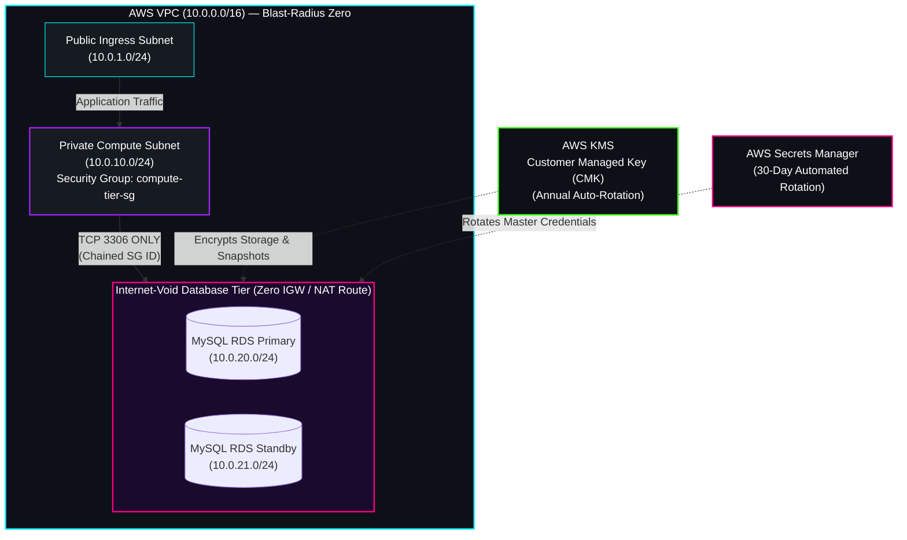

  

# Blast-Radius Zero: Secure Cloud Database Architecture

**Architect & Engineer:** Felicia (Fee) Lebeck (`Snoflake39`)  
**Discipline:** Cloud Infrastructure Security & Database Architecture  
**Core Stack:** AWS (VPC, RDS, KMS, Secrets Manager), Terraform, Debian Linux

## The Engineering Philosophy

Modern cloud security cannot rely on perimeter defense alone. "Blast-Radius Zero" is an Infrastructure-as-Code (IaC) deployment engineered under the assumption of breach. By decoupling identity from static credentials, enforcing cryptographic secrecy at rest with a Customer Managed Key (CMK), and isolating the database within an internet-void subnet, the data tier remains unreachable even if an edge asset is compromised.

## Architecture Flowchart

## Modular Architecture

* `versions.tf` — Enforces Terraform `>= 1.5.0` and locks the `hashicorp/aws` `~> 5.0` provider.
* `vpc.tf` — Provisions a three-tier VPC (`10.0.0.0/16`) with Public, Private Compute, and Isolated Database subnets (`10.0.20.0/24`, `10.0.21.0/24`) with zero routes to the Internet Gateway or NAT Gateway.
* `security.tf` — Implements Security Group chaining so TCP port `3306` only accepts traffic originating from the Compute Tier Security Group ID.
* `database.tf` — Deploys an encrypted MySQL RDS instance backed by a rotating AWS KMS Customer Managed Key and automated 30-day credential rotation via AWS Secrets Manager.

## Validation

Run `terraform init` and `terraform validate` to verify syntax and module integrity.
